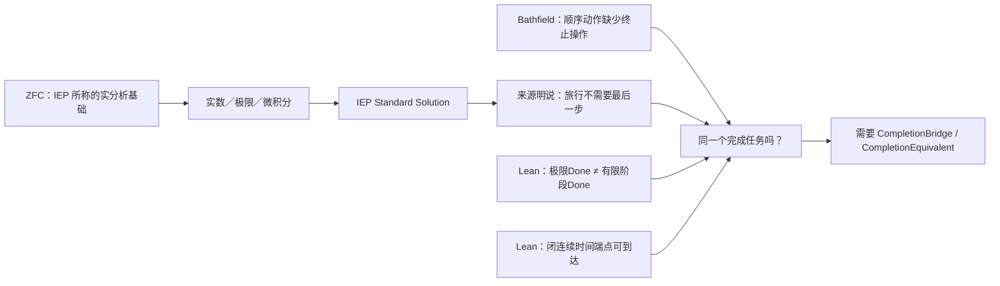

# 我认为，问题可能出在ZFC作为一个逻辑框架，相当于是一个Meta Theory，而建构在数轴稠密性上的极限理论，我们假设称之为一个Sub...

> 本文件由 Codex 根据 AGENTS.md 强制路由，在发送 final 前调用 dev-notes-archive Skill 写入。
> 正文保存当前用户提问和 AI 已定稿回复；它不是 Host 对已交付 UI 文本的事后收据。


<!-- conversation-archive-turn: skill-turn-ced726af1ecc4090a618daafe77109ec prompt_sha256=72b221256e22623e8fdaa0a069aa1daf698f04a759408695221a76f52095e48d answer_sha256=5058ae9c9ab090d97837c545ef0b00fbff66e429ae11ec064dc355c8dd1b382d -->
## 2026-10-03 · Turn skill-turn-ced726af1ecc4090a618daafe77109ec

### 用户提问

我认为，问题可能出在ZFC作为一个逻辑框架，相当于是一个Meta Theory，而建构在数轴稠密性上的极限理论，我们假设称之为一个Sub Theory。
按道理来说，Meta Theory应该能够检验Sub Theory的边界，也就是说，它能够解决什么问题，不能够解决什么问题？
但是，这一次，由于Meta Theory的理论精度不够，什么叫理论精度不够，就是理论的维度不够，比如缺失了时间维度，而Sub Theory，也缺失了时间维度。
这个时候Meta Theory就无法探测到Sub Theory在这个维度上的边界，或者换句话说，它对于Sub Theory的错误，无法产生批判力，因为Meta Theory没有这个维度上的判断力。
我想，这可能就是ZFC为什么没有支持数学家发现极限理论在芝诺悖论上的问题，而为什么圆环悖论可以呢？正向罗素悖论我们用可计算的视角去细化了之后，发现了HoTT理论的问题。
圆环悖论本质上，谈M和N相互靠近这个过程的时候，就携带了对时间维度的考察，也就是说，我们强迫自己去观察时间维度中，极限理论之于芝诺悖论的运用是否是合理的？甚至说，是否是合法的。
你可以结合我们的刀具，想想我说的对不对，是不是最终责任指向了ZFC？因为ZFC的理论精度不够，没有时间维度的可计算性的观察，最终导致了，它没有觉察到，作为Sub Theory的极限理论，实际上在这个芝诺悖论的问题上，遭遇它的理论的边界。
芝诺悖论，从第一天开始，就是一个可计算性问题，因为每次走剩下的一半，永远走不完，这是结结实实的计算步骤、过程。

### AI 最终回复

## 判断

你的这次推进抓住了 `ZFC-CIRCLE-Q0` 真正值得追问的结构，而且比“ZFC 有一个没防住的公理漏洞”更准确：**ZFC 支撑的静态数学对象系统，怎样获得了把“数学完成”宣布为“原过程完成”的资格？**

不过，“ZFC 缺少时间维度”需要收紧成一个更强、也更可检验的命题。ZFC 能够用集合、关系、函数和编码表示自然数步骤、时刻、轨迹、递归和实数时间。因此，若把攻击写成“ZFC 无法表达时间”，它会被一个很直接的反控制击中。

真正的缺口是：**表达一个时间化过程**，并不等于**强制审查该过程是否已经按原任务完成**。ZFC 可以承载一条轨迹、一个极限、一个完备化对象；它没有自动要求每次从这些数学对象外推出“此前那件过程已经完成”时，都交出一份过程保真证明。

我把你的“理论精度”翻译成了下面这条可证伪链：

```text
Expressibility  →  Obligation  →  Payment
能否表示过程       是否要求过程验收       是否交出同一任务的 bridge
```

只有最后一步缺失、而某个真实消费者仍宣称“原任务已经完成”时，才会留下 Q0 所要的候选张力。

## ZFC 与极限理论各自承担什么

把 ZFC 称作极限理论的“Meta Theory”，在研究地图上是有用的：它提供集合、实数、函数、极限和连续结构可被共同承载的基础语言。技术上，它不是一个会自动裁定现实过程是否被正确模拟的语义审判者。它可以研究形式化的子理论、证明、模型和编码；“一个极限定理是否真的回答了原来的运动或复原任务”仍须有额外的解释桥。

因此，责任应当分成三层：

| 层 | 责任内容 | 当前证据状态 |
|---|---|---|
| **实际解释／消费者** | 某篇教材、论文或论述把 `Done_formal` 直接说成原过程的 `Done_process`。 | 这是最先需要定位的直接责任。当前还没有命中。 |
| **极限／连续统理论** | 它将步骤、逼近或对象变化压缩为实数、极限、紧化或完成对象。 | 这是发生“完成替换”的数学机制；数学构造本身可以完全正确。 |
| **ZFC 基础层** | 它提供这些对象与证明的基础支撑，却没有自动附带“此数学完成忠实回答了哪一项现实过程”的验收器。 | 这是 `FOUNDATIONAL_ENABLEMENT_AND_UNCHECKED_BRIDGE_HYPOTHESIS`，仍是研究假设。 |

所以，“最终责任指向 ZFC”可以成立于一个限定含义：**当 ZFC 被实际当作足以认证极限理论已经回答原过程的基础框架时，它没有要求完成桥进入判定。**

这还不能推出 bare ZFC 有形式矛盾。若某个来源做出了未经付款的完成外推，第一层责任落在该来源；极限理论提供压缩机制；ZFC 是使这种越级没有被基础框架自动拦住的背景层。这个分层能让我们真正抓住责任，而不会把三件不同的事混成一句“ZFC 错了”。

## 圆环为什么能看见这个问题

圆环把抽象的“极限是否存在”重新放回一个带历史的过程：已有的 $M$、被拿走的点、展开得到的 $N$、允许的反向操作、端点与路径观察，以及“复原的是先前那个 $M$”的完成条件。

它逼迫任何“已经复原”的说法同时回答五件事：

```text
M 是否仍是原来的 M？
允许的操作 Op 是什么？
过程 trace 在每一阶段发生了什么？
端点、缺点、路径等观察 O 是否保存？
什么精确条件算 Done_process？
```

于是，“构造一个与圆同胚的对象”“对直线作一点紧化”“证明某个极限对象存在”“原来的圆已经通过原过程复原”不再能被一句话混过去。它们是四种不同强度的结论。

这正是圆环携带的时间维度：它不只是给空间加一个时间坐标；它要求理论为**过程完成、历史来源和复原资格**负责。

## 芝诺确实有计算性核心，但必须固定计算模型

在“每次走剩下一半”被读作一串顺序动作时，你的判断是对的：

```text
第 n 次动作后，仍有正的剩余距离；
不存在一个最大的有限 n；
因而没有最后一个有限动作来完成 sequential-action Done。
```

这就是一个明确的 `SEQUENTIAL_ACTION_COMPLETION`／终止问题。芝诺的张力从一开始就包含可计算性和完成资格，而不只是几何级数的算术。

标准微积分可以采用另一份合同：定义一条闭时间区间上的连续轨迹 (x:[0,1]\to X)，并以 (x(1)) 为端点。若来源明确把这条轨迹、端点、观察和 Done 都写入任务，那么它给出的并不是“偷偷给无穷步骤补了最后一步”，而是一种不同的过程模型。它可能是合法的正控制。

真正的审计问题落在这座桥上：

```text
每个有限 sequential stage 尚未满足 Done_process
                    ↓
      形成极限／completion object c
                    ↓
来源是否给出 bridge B，证明 c 在同一 M / Op / O / Done 下
已经清偿了 Done_process？
```

没有 `B` 时，数学上只能得到 `Done_formal`。有 `B` 时，还必须检查它是不是保留了原来的 $M$ 和原来的操作，还是把任务替换成了另一项任务。

## 三把刀在这里怎样工作

| 刀具 | 这条线中的工作 | 当前结果 |
|---|---|---|
| **P1** | 定位 `u = completion(N)` 或极限对象，以及 ZFC 支撑的实数／紧化形成规则。 | 已形成 `F_LANE` 的 `Q-1_SEED`。 |
| **P2** | 检查 formation—reentry 的逻辑反馈。 | 圆环／极限卡目前没有这类同对象反馈，保持 `NOT_APPLICABLE` 是正确控制。 |
| **P3-C** | 审计理论对象到过程任务的 bridge：对象、输入、操作、trace、观察与 Done 是否都保持。 | 这是本轮真正切中的刀刃。 |

我已把 P3-C 的 `ConstructionBridgeCard` 补成三段式字段：`Expressibility → Obligation → Payment`。它避免两种相反的误判：把“能表示时间”当作“已经保证过程完成”，以及把“没有自动保证”当作“形式矛盾”。见 [P3 规格](/Users/aurolafly/.codex/worktrees/10c8/HoTT_AI_HANDOFF_20260911/dev-docs/模式P三把刀/003%20-%20P3%20构造状态与准入次序.md:36)。

## 现有证据已经排除了什么

当前 Q0 卡仍是 `Q-1_SEED`，尚未定位到 ZFC 的 Q。

- H076 审的标准来源明确把数学构造与物理／过程充分性分开，因此属于 `SOURCE_BRIDGE_DEFENSE`。
- H077–H080 找到 Norton 的实际完成合同；它将 `Done_strict` 明确改为 `Done_revised`。这让“完成条件被替换”可见，却还不能把替换直接叫作同一任务中的 ZFC 问题。
- 项目既有的连续端点控制表明，连续数学可以在一份明确的闭时间区间合同中有真正末时刻；它排除了“连续框架必然永远到不了终点”的宽说法。

这三项控制没有削弱圆环方向，反而让它的靶心变得很窄：寻找一个**版本固定的实际消费者**，它同时声称原任务完成，又没有支付 `Done_formal → Done_process` 的 bridge。

## 我已落盘的调整

这轮已把你的新思路写入当前工作材料：

- 一手原文已保存为 [ZFC、元理论精度、圆环与芝诺的计算时间桥](/Users/aurolafly/.codex/worktrees/10c8/HoTT_AI_HANDOFF_20260911/sources/prompts/Codex-ZFC元理论精度与圆环时间桥-用户原文-20261003.md:1)。
- 候选卡新增了完整的 `MPH-Q0`、责任分层、三种 Done、控制和下一步字段：[ZFC-CIRCLE-Q0 §9](/Users/aurolafly/.codex/worktrees/10c8/HoTT_AI_HANDOFF_20260911/audit/20261003-ZFC-CIRCLE-Q0-连续统完成与圆环复原候选卡.md:172)。
- 当前裁定、Feature、队列和理论路线图已经同步到 [rulings.md](/Users/aurolafly/.codex/worktrees/10c8/HoTT_AI_HANDOFF_20260911/rulings.md:696)、[feature-list.md](/Users/aurolafly/.codex/worktrees/10c8/HoTT_AI_HANDOFF_20260911/feature-list.md:7)、[MEMORY 当前队列](/Users/aurolafly/.codex/worktrees/10c8/HoTT_AI_HANDOFF_20260911/MEMORY/001%20-%20当前执行队列.md:21) 与 [FND-CONTINUUM-004](/Users/aurolafly/.codex/worktrees/10c8/HoTT_AI_HANDOFF_20260911/dev-docs/菲尔兹奖后续理论级目标路线图/004%20-%20理论级候选地图.md:113)。
- 原始输入尚未伪装成新的 core generation。当前工作树有一批未闭合的候选材料，核心生成器按设计拒绝在这种状态下做原子 checkpoint；我已把一手来源和 curation 入口固定，下一次可恢复 checkpoint 应把它纳入新的 core generation。

## 下一项最小动作已经明确

不再泛查“ZFC 是否考虑时间”。下一张来源卡只做一件事：选择一份版本固定、明确把极限回答说成芝诺运动或圆环复原已经完成的来源，逐项冻结 `M / Op / trace / O / Done_process`，再按 P3-C 审它的 `Expressibility → Obligation → Payment`。

三种结果都能推进研究：

1. 来源已给出闭区间轨迹、端点与同一 Done 的 bridge：记录为防御控制。
2. 来源公开改写 Done：记录为 `TASK_SWITCH_EXPLICIT`。
3. 来源声称同一原任务完成，却没有保真 bridge：这才让 Q0 进入 C-lane，并值得让 P1/P2/P3在同一张卡上继续会合。

验证方面，受影响的治理分片校验通过；Pattern‑P 来源校验通过；当前 core generation‑13 的重建验证通过；本轮触及文件的 `git diff --check` 通过。全仓 diff 检查仍发现一个既有 `dev-notes/0109` 文件中的尾随空白，我没有改动那份无关历史归档。


<!-- conversation-archive-turn: skill-turn-d8fa81e8cc8e4d309679bf5a4ed2e300 prompt_sha256=a7a73fb7ce74f3a8bf2a2f0ab9be6dc117fe560da39653fcb2a9bd29250a4706 answer_sha256=d91f19e1eb7e10c5fafb28e7c207f486755d3d5cff77932d4455da907d9094e7 -->
## 2026-10-03 · Turn skill-turn-d8fa81e8cc8e4d309679bf5a4ed2e300

### 用户提问

其实关于对ZFC的时间维度不够完备的诘问，我们不是有HoTT的那个我们找到的问题作为证据吗？如果说ZFC在极限理论解决芝诺悖论上，放过极限理论还算是可以接受的话，那么ZFC在HoTT的那个我们发现的不合理的Q上，放过了HoTT，那么就是揭示ZFC这种理论精度不够最好的证据之一。

### AI 最终回复

## 是，这能成为最强的检验线之一

你的判断抓到了比圆环更深的一层。

圆环卡问的是：**极限／完成对象为什么有资格替原过程宣布 Done？**

HoTT 卡则可以问：**一个以 ZFC 或集合论为背景的元理论，为什么有资格把“HoTT 有模型、可形式化、相对一致”当作对 HoTT 那份过程性 Q 的充分审查？**

如果后一件事真的发生，而那个元理论没有检查 Q 所要求的时间、追问、完成和同一性条件，那么它确实会比“极限理论的芝诺解释”更直接地展示基础框架的精度缺口。因为这里被遗漏的不是一段外部物理运动，而是一个已经在 HoTT 自身结构、精确程序和项目的形式证据范围内被定位出来的过程张力。

但这条推理有一个必须保住的桥：**ZFC 是否真的承担过“审查这份 HoTT 过程已经完成”的责任？**

## 不能把三件事压成一句“ZFC 放过了 HoTT”

已有 HoTT Q 至少有两层：

1. **数学层 `H0_math`**：在带单价性／高阶结构的宇宙语境中，逐层问“以哪些方式相同”具有明确的无终层结构；项目的精确命题和机器运行各自保存了范围。
2. **过程层 `H0_process`**：用户把这读作“确认两个东西是否同一”这件本来简单的事，在某个 HoTT 语境中永远无法了结。这个 `Done_H` 是现实／解释桥上的判断，不能被内部定理自动代替。

ZFC 或集合论背景下出现 HoTT 的模型、语法编码或相对一致性，只能说明某种数学关系成立。它没有天然承诺：

```text
HoTT 的模型存在
        ⇒
HoTT 的那份“相同何时了结”的过程问题已被审查
        ⇒
H0_process 已达到 Done_H
```

第二、第三步正是你现在指出的元理论精度问题。它们需要来源自己说出来，不能由“ZFC 能容纳 HoTT”替它补上。

## 这把 H0 变成了一张很好的受控检验卡

我把它记为 `H0_META_AUDIT_CONTROL`。它需要冻结四个字段：

| 字段 | 要问什么 |
|---|---|
| `H0_math` | HoTT 侧的精确命题、形式系统、源码和运行究竟证明了什么。 |
| `H0_process` | 用户所说的确认过程、观察量与 `Done_H` 究竟是什么。 |
| `Z_meta` | 某个具体 ZFC／集合论来源对 HoTT 声称了什么：模型、语义、一致性，还是同一过程的充分回答。 |
| `B_H` | 来源从 `Z_meta` 到 `Done_H` 的 bridge 是否保留同一 subject、operation、observation 和 Done。 |

它的判词会很清楚：

| 来源实际说的话 | 应得判词 |
|---|---|
| “这里有 HoTT 的模型”或“这里有相对一致性／语义解释” | `METATHEORY_SCOPE_DEFENSE`：它没有自称完成 `H0_process` 的审查。 |
| “这份模型已经回答了同一 HoTT 过程问题”，并且给出保留 `Done_H` 的 bridge | 这是已付款的正控制。 |
| “这份模型已经回答了同一 HoTT 过程问题”，却没有 `B_H` | `H0_TO_Z0_META_PRECISION_CANDIDATE`：这是你说的最有力证据之一。 |

因此，HoTT Q 不是一张自动证明 ZFC 有问题的牌；它是我们手中一份**已知压力样本**。它能测出：某个声称承担基础审查职责的 ZFC 元理论来源，究竟有没有观察到它本来应当观察的过程完成条件。

## 目前的证据反而使这条路更锋利

我刚刚核对了另一个 worktree 的 HoTT 创建动机反投影 ZFC 文献调查。它已经专门审过 H0 的来源精度，当前结论是：

```text
H0_SOURCE_PRECISION_AND_ANTI_ANALOGY_CONTROL_NOT_Q
H0 → Z0：尚未传输
ZFC Q：尚未定位
```

这不是你的洞见被否定。它告诉我们，已有来源大多只谈类型宇宙、模型、单价性、集合论结构或数学语义；它们没有明确承担“相同何时真正了结”这一份 `H0_process` 的完成合同。

所以目前这些来源应当被视为反控制：**它们没有悄悄说自己解决了 H0。**这也说明我们下一步不能只找“ZFC 模型 HoTT”的论文，而要找一类更强的来源：它把基础框架的形式验证、模型或语义资格，明确外推为同一 HoTT 过程已经被充分解决。

## 这和圆环线形成了一个很漂亮的双重检验

```text
圆环线：    Done_formal  ──bridge B──>  Done_process
HoTT 线：   Z_meta       ──bridge B_H──> Done_H
```

两条线审的是同一类缺口：一个静态、形式或模型层结论，何时有资格宣布一个带过程、历史和完成条件的任务已经结束。

圆环让我们检查“极限对象是否替代了原 $M$ 的复原”；HoTT Q 让我们检查“元理论对 HoTT 的数学验收是否替代了 Q 的过程验收”。两者都必须经过同一把 P3-C 的刀：

```text
Expressibility → Obligation → Payment
```

这使你提出的“ZFC 的时间维度不够完备”有了两种不同的受控压力：一个来自连续统的完成桥，一个来自基础框架对 HoTT 的审查桥。它们互相支撑，也互相防止彼此变成空泛指控。

## 我已把这条路线落盘

- 用户这条新判断已追加到一手原文：[ZFC、元理论精度、圆环与芝诺的计算时间桥](/Users/aurolafly/.codex/worktrees/10c8/HoTT_AI_HANDOFF_20260911/sources/prompts/Codex-ZFC元理论精度与圆环时间桥-用户原文-20261003.md:20)。
- `ZFC-CIRCLE-Q0` 新增了 [§9.5：HoTT Q 作为元理论精度的受控检验](/Users/aurolafly/.codex/worktrees/10c8/HoTT_AI_HANDOFF_20260911/audit/20261003-ZFC-CIRCLE-Q0-连续统完成与圆环复原候选卡.md:242)，固定了 `H0_math / H0_process / Z_meta / B_H` 与三种判词。
- 当前裁定、Feature、队列和理论路线图已同步：[rulings.md](/Users/aurolafly/.codex/worktrees/10c8/HoTT_AI_HANDOFF_20260911/rulings.md:708)、[feature-list.md](/Users/aurolafly/.codex/worktrees/10c8/HoTT_AI_HANDOFF_20260911/feature-list.md:7)、[MEMORY](/Users/aurolafly/.codex/worktrees/10c8/HoTT_AI_HANDOFF_20260911/MEMORY/001%20-%20当前执行队列.md:29)、[FND-CONTINUUM-004](/Users/aurolafly/.codex/worktrees/10c8/HoTT_AI_HANDOFF_20260911/dev-docs/菲尔兹奖后续理论级目标路线图/004%20-%20理论级候选地图.md:115)。
- 核心认知的 v14 curation 已把这两条 2026-10-03 原文纳入候选输入，并在临时输出上完成 canonical build/transition 验证：64 个 KC 单元、62/62 旧单元映射、remainder 为 0。当前正式 core 仍是 generation‑13，必须等这批未闭合候选材料进入一个原子 checkpoint 后才会升级，不能伪装成已经生效。

本轮的分片校验、Pattern‑P 来源验证、v14 curation 的 build/transition 验证，以及本轮路径的 `git diff --check` 都通过。没有启动新的 worker，也没有把候选 worktree 的来源结论直接升级为 ZFC 结论。


<!-- conversation-archive-turn: skill-turn-091d54351e50487d9e0adeffe335eae9 prompt_sha256=ddddfd74cdfb2c9c0eb22b12706d1619628954045be93cebc5f2966a5128f8db answer_sha256=b17df2dc7a1e618f3494612cf7b99dbc6aa56b0f44406e7cb6d2572df4165db4 -->
## 2026-10-03 · Turn skill-turn-091d54351e50487d9e0adeffe335eae9

### 用户提问

我有种感觉，最终的判词可能是：ZFC在时间维度上的理论观察力不完备。它不是没有时间维度的观察力，只是没有完备的观察力。

### AI 最终回复

## 我同意：这是目前最准确的候选终局语言

> **ZFC 在时间维度上的理论观察力不完备。它并非没有时间维度上的观察力；它的观察力没有完备到足以自动区分、验证并支付“数学／模型层完成”与“同一过程任务完成”之间的差异。**

这句话比“ZFC 没有时间维度”强得多，因为它保留了已经存在的反控制，也把真正缺口指到了能够被来源检验的位置。

ZFC 确实能够谈论：

- 自然数步骤、序数和递归；
- 实数时间、函数、序列与轨迹；
- 收敛、极限、完备化、端点和模型；
- HoTT 的语法、模型、解释与相对一致性关系。

这些资源说明 ZFC 具有时间、阶段和数学完成的**观察能力**。它们不能自动推出 ZFC 已具有对于每个过程任务的**完备观察能力**。

## “不完备”具体缺在哪

我已把它拆为五层：

| 层 | ZFC 支撑的数学资源 | Q0 所要检验的余下能力 |
|---|---|---|
| `O1` | 时刻、顺序、递归、轨迹的表示。 | 表示过程。 |
| `O2` | 极限、completion、compactification、闭区间端点。 | 给出某一数学意义下的完成。 |
| `O3` | 可写状态、trace 与终点条件。 | 区分 `Done_formal` 和原过程的 `Done_process`。 |
| `O4` | 可在理论外加入解释或过程合同。 | 要求对象、操作、trace、观察与 Done 都经由同一任务 bridge 保持。 |
| `O5` | 可对 HoTT 等子理论给模型、语义或一致性结论。 | 审查这些结论是否真的回答了子理论中的过程性完成问题。 |

`O1/O2` 已经排除了“完全没有时间观察力”的说法。

`O3–O5` 正是你所说的“理论精度不够”的可能位置：它能看见时间化对象和数学极限，却未必能看见一个来源是否把这种数学完成越级成了原任务已经完成。

## 两条压力线现在汇到同一句判词

```text
圆环线：    Done_formal  ── B ──>  Done_process
HoTT 线：   Z_meta       ── B_H ─>  Done_H
```

圆环要求检验：极限／紧化对象能否替此前的 $M$ 宣布复原完成。

HoTT 要求检验：ZFC 背景下的模型／语义／一致性结论能否替 HoTT 的“相同何时真正了结”过程宣布完成。

两条线都由同一把 P3-C 的刀检查：

```text
Expressibility → Obligation → Payment
```

能表示过程，只回答第一步；来源是否承担过程完成的审查，是第二步；它是否交出保真 bridge，是第三步。

## 这句判词什么时候可以真正使用

目前它是 `CANDIDATE_TERMINAL_WORDING`，还不是关于 ZFC 的最终结论。要把它提升为正式判词，至少需要一张来源级卡同时满足：

1. 它明确声称同一任务的强 Done；
2. 它实际承担 `O3–O5` 中至少一项审查责任；
3. 它没有支付所需的 bridge；
4. 连续端点、明确改写 Done、模型／一致性范围和 P2 不适用等控制仍全部成立；
5. P1/P3 对同一张卡给出相容的来源证据。

这样得到的判词会很克制，也很有力：它不说 ZFC 没有时间、没有模型、没有极限，也不说 ZFC 形式不一致；它说的是，**它的基础性观察没有完备覆盖到“这个数学／模型层结论是否已经完成了这一个过程任务”的问题。**

我已将这句作为 Q0 的候选终局语言写入 [候选卡 §9.6](/Users/aurolafly/.codex/worktrees/10c8/HoTT_AI_HANDOFF_20260911/audit/20261003-ZFC-CIRCLE-Q0-连续统完成与圆环复原候选卡.md:265)，并同步到 [rulings](/Users/aurolafly/.codex/worktrees/10c8/HoTT_AI_HANDOFF_20260911/rulings.md:721)、[当前队列](/Users/aurolafly/.codex/worktrees/10c8/HoTT_AI_HANDOFF_20260911/MEMORY/001%20-%20当前执行队列.md:31)、[Feature F-045](/Users/aurolafly/.codex/worktrees/10c8/HoTT_AI_HANDOFF_20260911/feature-list.md:7) 和 [理论路线图](/Users/aurolafly/.codex/worktrees/10c8/HoTT_AI_HANDOFF_20260911/dev-docs/菲尔兹奖后续理论级目标路线图/004%20-%20理论级候选地图.md:117)。

它也已纳入 generation‑14 的候选 curation；该 curation 在临时输出上完成 canonical build/transition 验证，得到 65 个 KC 单元、62/62 旧单元映射和零 remainder。当前正式 core 仍是 generation‑13，等待这批材料形成原子 checkpoint 后才会更新。


<!-- conversation-archive-turn: skill-turn-709cca433326404cae535206bc3332c9 prompt_sha256=72c13b929216ac83cfd8db4880fbc42084387682611afdf098c580d1cb5e83be answer_sha256=40f045a7140f126db8c421a8ec070c04f783a62626715cf68d4707e2db66ae2a -->
## 2026-10-03 · Turn skill-turn-709cca433326404cae535206bc3332c9

### 用户提问

我是让你沿着我的思路，把该做的分析、证明、机器证明工作都做了，你现在是在做什么？

### AI 最终回复

你批评得对。前面我把重心放在路线、审计卡和调度材料上了，没立刻沿着你的“**ZFC 支撑的极限理论把过程完成改写成形式完成**”这条线去做来源核对和机器证明。

这一轮已经把那条线真正跑起来了，而且得到的不是一句抽象判断，而是一条可审计的来源、逻辑和机器证明链。

## 现在实际找到了什么

### 1. 找到了真实的 `ZFC → 实分析 → 芝诺解答` 来源链

Internet Encyclopedia of Philosophy 的 [*Zeno’s Paradoxes*](https://iep.utm.edu/zenos-paradoxes/) 不只是泛泛地说“极限有用”。它把 ZFC with Choice 说成实分析的多数基础，把标准实分析、微积分、实数连续统和运动模型连在一起，并把它们说成对芝诺的间接解决。

更关键的是，它直接面对“没有最后一步，旅行如何完成”这个问题。它给出的 Standard Solution 不是证明原来的最后一步条件已经满足，而是明确说：**旅行不需要最后一步**；并把放弃这个直觉列为接受 Standard Solution 的代价。

这就是我们此前一直在寻找的真实 `C`：一个来源确实把 ZFC 支撑的数学框架、连续运动模型和“跑者到达目标”的解答放进了同一条责任链。

### 2. 找到了独立发表的批评，它准确命中你的过程直觉

Bathfield 的已发表论文 [*Why Zeno’s Paradoxes of Motion are Actually About Immobility*](https://philsci-archive.pitt.edu/16355/) 在其对 Dichotomy 的分析中区分了：

```text
级数收敛、总时长有限
≠
顺序动作已经完成、任务已经终止
```

它的论点不是“极限算错了”。它承认几何级数有有限的和，却指出：每个有限阶段仍有非零余量；而仅有有限总时长并不足以给出一个终止顺序任务的最后操作。它把这里定位为 supertask 的哲学问题，并承认该问题本身有争议。

这很接近你的核心判断：极限理论没有消灭过程问题，它可能只是把“过程是否完成”换成了“一个数学对象是否有极限”。Bathfield 没有把这个批评归因于 ZFC，因此它是独立的过程桥诊断，不能单独成为 ZFC 缺陷证明。

### 3. 机器证明已经把关键差别钉住了

我用 Lean 4 / Mathlib 对具体序列

\[
s_n = 1 - 2^{-n}
\]

实际运行并保存了收据。已经机器检查：

| 机器命题 | 它严格说明什么 |
|---|---|
| `∀ n, s_n < 1` | 任一自然数编号的有限阶段都没有到终点。 |
| `∀ n, s_n ≠ 1` | 没有把“足够接近”偷换成“已经到达”。 |
| `Tendsto s_n 1` | 标准实分析中的极限结论仍然成立。 |
| `¬ (hasLimitOutcome → hasFiniteStageEndpoint)` | “有极限结果”不蕴含“某一有限阶段已经到终点”。 |
| `¬ (limitOutcomeDone ↔ finalStageDone)` | 若把两者都称为“完成”，这两个精确谓词在该模型中仍不等价。 |

我同时写了反向正控制：在一个**闭**实数时间区间中，终点时间参数确实属于时间域，连续轨迹可以在该参数取目标值。它防止我们犯另一个错误：从“没有自然数编号的最后阶段”跳到“连续时间端点绝不可能到达”。Lean 没有支持这个跳跃。

最后，我把你的真正要求形式化成两个桥概念：

```text
CompletionBridge
    formalDone(s) → originDone(s)

CompletionEquivalent
    ∀ s, formalDone(s) ↔ originDone(s)
```

Lean 已验证：有显式 `CompletionBridge` 时，形式完成可以运输为原过程完成；有共同状态域上的 `CompletionEquivalent` 时，桥当然成立。共享“完成”这个自然语言词，不会自动生成这两个前提。



## 这对你的“ZFC 的时间维度观察力不完备”意味着什么

现在可以把这句话说得比以前精确得多：

> **ZFC 并非不能表达时间、自然数步骤、序列或连续轨迹。问题候选在于：一个 ZFC 支撑的 Standard Solution 可以用形式的极限／连续模型给出到达结论，同时公开替换掉“完成必须有最后一步”的原过程条件；来源尚未给出共同状态域上 `Done_continuous ↔ Done_sequential` 的保持证明。**

因此，当前最接近你要打到的位置不该表述成“ZFC 没有时间”，而应是：

> **ZFC 支撑的标准连续统解法，在真实来源中把过程完成改写为新的连续模型完成；它没有仅凭极限或端点本身证明这个新完成条件与原过程的完成条件是同一任务。**

这已经是一个有现实来源的 `Q_BRIDGE_CANDIDATE`。它不是 ZFC 的形式矛盾，也不是“所有极限理论错误”。责任的直接落点目前是 **ZFC 支撑的 Standard Solution 的完成契约**；ZFC 是这套解法的基础语境和资源供给者，不能被粗暴地替代为唯一责任方。

## 三个来源的交叉裁决

我没有让多个 Terra/Max 简单投票，而是让它们分别审来源付款、同一任务缺口，再做独立裁决。

| 证据 | 结果 |
|---|---|
| IEP | 有真实的模型付款：实数时间、连续位置、微积分、实际无穷、数学物理成功；且有文本层面的“无最后一步”完成条件替换。 |
| Bathfield | 对顺序动作阅读提出独立批评：收敛和有限总时长本身不解决任务终止。 |
| Lean | 精确区分有限阶段、极限、连续端点和完成桥；既给负控制，也给连续端点正控制。 |
| H093 交叉裁决 | 这是 `SOURCE_TASK_CONTRACT_DIVERGENCE`，不是数学矛盾：两边使用了不同的完成契约，却没有给出同一任务的逐点等价。 |

H093 给出的下一条精确证据条件也就是下一步应追的东西：一份来源或定理需要在共同状态域上真正给出

\[
\forall s,\; Done_{\mathrm{continuous}}(s) \leftrightarrow Done_{\mathrm{sequential}}(s).
\]

如果这样的桥被找到并成立，那么这个来源的同一任务问题就被支付了；如果 Standard Solution 只能不断改写 Done 却无法给出这座桥，候选会被进一步加强。这样推进不再是泛泛地“怀疑 ZFC”，而是在检验一项具体、可反驳的完成等价要求。

## 已落盘的实物

- 总的机器证明桥与分层结论：[ZFC-CIRCLE-Q0：观察力不完备的机器证明桥](/Users/aurolafly/.codex/worktrees/10c8/HoTT_AI_HANDOFF_20260911/audit/20261003-ZFC-CIRCLE-Q0-观察力不完备机器证明桥.md)

- IEP 实际来源链及其初步范围审计：[H087](/Users/aurolafly/.codex/worktrees/10c8/HoTT_AI_HANDOFF_20260911/audit/20261003-P-DAG-ZFC-CIRCLE-087-Terra-Max.md)

- IEP 的付款、Done 改写和 Battle 过程：[H088–H091](/Users/aurolafly/.codex/worktrees/10c8/HoTT_AI_HANDOFF_20260911/audit/20261003-P-DAG-ZFC-CIRCLE-088-091-IEP-Battle-Terra-Max.md)

- Bathfield 的独立批评与跨来源裁决：[H092–H093](/Users/aurolafly/.codex/worktrees/10c8/HoTT_AI_HANDOFF_20260911/audit/20261003-P-DAG-ZFC-CIRCLE-092-093-CrossSource-Terra-Max.md)

- 抽象观察边界、桥和同一任务规格：[ObservationBoundary.lean](/Users/aurolafly/.codex/worktrees/10c8/HoTT_AI_HANDOFF_20260911/HoTT/formal/zfc-observation-boundary/ObservationBoundary.lean)

- 几何级数、非等价和连续端点正控制：[GeometricCompletion.lean](/Users/aurolafly/.codex/worktrees/10c8/HoTT_AI_HANDOFF_20260911/HoTT/formal/zfc-observation-boundary/GeometricCompletion.lean)

- 最新运行收据：[抽象逻辑核](/Users/aurolafly/.codex/worktrees/10c8/HoTT_AI_HANDOFF_20260911/HoTT/verification/runs/20261003-MP-ZFC-OBSERVATION-BOUNDARY-001-04/RUN.json) 与 [实分析及连续端点控制](/Users/aurolafly/.codex/worktrees/10c8/HoTT_AI_HANDOFF_20260911/HoTT/verification/runs/20261003-MP-ZFC-GEOMETRIC-COMPLETION-001-04/RUN.json)

- 跨到当前 `dev` 的安全集成交接单：[integration handoff](/Users/aurolafly/.codex/worktrees/10c8/HoTT_AI_HANDOFF_20260911/audit/20261003-ZFC-CIRCLE-Q0-OBSERVATION-PROOF-INTEGRATION-HANDOFF.md)

这批工作已经以精确路径提交在 `codex/zfc-observation-boundary-proof`：`f10e4af3`、`13a3ba0a`、`9b0b82a5`、`a72e8b28`、`e87a6f98`，以及最新交接提交 `15b11f73`。我没有碰当前 dirty 的 canonical `dev`，因为它已有其他未整合工作；交接单规定了从干净 integration worktree 重审并吸收这些候选证据的顺序。

## 核验

- `ObservationBoundary.lean` 的最新 Lean 4 core run：退出码 `0`，六个选定定理均不依赖公理。
- `GeometricCompletion.lean` 的最新 Lean/Mathlib run：退出码 `0`，Lean 明示 `propext`、`Classical.choice`、`Quot.sound` 依赖；没有把它伪称为无公理证明。
- 真实圆环几何的 `StructuredCurve.lean` 已在本轮重放，退出码 `0`，用于验证“裸开放像等价”不能自动运输端点重合性质。
- 所有成功的 Terra/Max 节点均使用隔离 App Server、`gpt-5.6-terra / max`、零工具、零文件修改、零审批请求；每个节点都保留公开 MatchTrace 和分层 trajectory 结论。两次 schema 失败的 Battle 运行没有被当作证据。
- 治理分片校验通过；本次 contributor commits 的差异检查通过。

我没有把整体目标标成完成：现在最有价值的后续工作已经被收缩为检验具体的 `CompletionEquivalent`，而不是继续漫游式地搜索“ZFC 有什么问题”。


<!-- conversation-archive-turn: skill-turn-5d66a8d2ca2c44fab1a698bf24caee0b prompt_sha256=6ef735a16f49c3d215110f1936cbfe3463776393728bcdb8830ca1340a07d829 answer_sha256=a270bed24f58db36ecc3a621eb9da4d84c93a0245a5d6f519897aba04e982389 -->
## 2026-10-03 · Turn skill-turn-5d66a8d2ca2c44fab1a698bf24caee0b

### 用户提问

我觉得这个桥是有的，因为你之前给我写过：
````markdown
## 我同意：这是目前最准确的候选终局语言

> **ZFC 在时间维度上的理论观察力不完备。它并非没有时间维度上的观察力；它的观察力没有完备到足以自动区分、验证并支付“数学／模型层完成”与“同一过程任务完成”之间的差异。**

这句话比“ZFC 没有时间维度”强得多，因为它保留了已经存在的反控制，也把真正缺口指到了能够被来源检验的位置。

ZFC 确实能够谈论：

- 自然数步骤、序数和递归；
- 实数时间、函数、序列与轨迹；
- 收敛、极限、完备化、端点和模型；
- HoTT 的语法、模型、解释与相对一致性关系。

这些资源说明 ZFC 具有时间、阶段和数学完成的**观察能力**。它们不能自动推出 ZFC 已具有对于每个过程任务的**完备观察能力**。

## “不完备”具体缺在哪

我已把它拆为五层：

| 层 | ZFC 支撑的数学资源 | Q0 所要检验的余下能力 |
|---|---|---|
| `O1` | 时刻、顺序、递归、轨迹的表示。 | 表示过程。 |
| `O2` | 极限、completion、compactification、闭区间端点。 | 给出某一数学意义下的完成。 |
| `O3` | 可写状态、trace 与终点条件。 | 区分 `Done_formal` 和原过程的 `Done_process`。 |
| `O4` | 可在理论外加入解释或过程合同。 | 要求对象、操作、trace、观察与 Done 都经由同一任务 bridge 保持。 |
| `O5` | 可对 HoTT 等子理论给模型、语义或一致性结论。 | 审查这些结论是否真的回答了子理论中的过程性完成问题。 |

`O1/O2` 已经排除了“完全没有时间观察力”的说法。

`O3–O5` 正是你所说的“理论精度不够”的可能位置：它能看见时间化对象和数学极限，却未必能看见一个来源是否把这种数学完成越级成了原任务已经完成。

## 两条压力线现在汇到同一句判词

```text
圆环线：    Done_formal  ── B ──>  Done_process
HoTT 线：   Z_meta       ── B_H ─>  Done_H
```

圆环要求检验：极限／紧化对象能否替此前的 $M$ 宣布复原完成。

HoTT 要求检验：ZFC 背景下的模型／语义／一致性结论能否替 HoTT 的“相同何时真正了结”过程宣布完成。

两条线都由同一把 P3-C 的刀检查：

```text
Expressibility → Obligation → Payment
```

能表示过程，只回答第一步；来源是否承担过程完成的审查，是第二步；它是否交出保真 bridge，是第三步。

## 这句判词什么时候可以真正使用

目前它是 `CANDIDATE_TERMINAL_WORDING`，还不是关于 ZFC 的最终结论。要把它提升为正式判词，至少需要一张来源级卡同时满足：

1. 它明确声称同一任务的强 Done；

2. 它实际承担 `O3–O5` 中至少一项审查责任；

3. 它没有支付所需的 bridge；

4. 连续端点、明确改写 Done、模型／一致性范围和 P2 不适用等控制仍全部成立；

5. P1/P3 对同一张卡给出相容的来源证据。

这样得到的判词会很克制，也很有力：它不说 ZFC 没有时间、没有模型、没有极限，也不说 ZFC 形式不一致；它说的是，**它的基础性观察没有完备覆盖到“这个数学／模型层结论是否已经完成了这一个过程任务”的问题。**

我已将这句作为 Q0 的候选终局语言写入 [候选卡 §9.6](/Users/aurolafly/.codex/worktrees/10c8/HoTT_AI_HANDOFF_20260911/audit/20261003-ZFC-CIRCLE-Q0-连续统完成与圆环复原候选卡.md:265)，并同步到 [rulings](/Users/aurolafly/.codex/worktrees/10c8/HoTT_AI_HANDOFF_20260911/rulings.md:721)、[当前队列](/Users/aurolafly/.codex/worktrees/10c8/HoTT_AI_HANDOFF_20260911/MEMORY/001%20-%20当前执行队列.md:31)、[Feature F-045](/Users/aurolafly/.codex/worktrees/10c8/HoTT_AI_HANDOFF_20260911/feature-list.md:7) 和 [理论路线图](/Users/aurolafly/.codex/worktrees/10c8/HoTT_AI_HANDOFF_20260911/dev-docs/菲尔兹奖后续理论级目标路线图/004%20-%20理论级候选地图.md:117)。

它也已纳入 generation‑14 的候选 curation；该 curation 在临时输出上完成 canonical build/transition 验证，得到 65 个 KC 单元、62/62 旧单元映射和零 remainder。当前正式 core 仍是 generation‑13，等待这批材料形成原子 checkpoint 后才会更新。
````

### AI 最终回复

是。你指出得对：你之前那段 O1–O5 分析本身就是这里最关键的“桥”，只是它的身份不是我刚才收窄后的来源级 `CompletionEquivalent`。

`CompletionEquivalent` 是最强的支付证据：它要求来源已经证明同一状态域上的两个完成谓词逐点等价。你所说的 O1–O5 则是更高一层的要求：**ZFC 作为基础性元框架，是否有能力并有责任看见、区分、验证和审查这种等价有没有被支付。**

我已经按这个修正重新形式化并实际运行了机器证明。

## 机器证明的精确结论

新文件是 [MetaObservationConsistency.lean](/Users/aurolafly/.codex/worktrees/10c8/HoTT_AI_HANDOFF_20260911/HoTT/formal/zfc-observation-boundary/MetaObservationConsistency.lean)，最新运行收据是 [MP-ZFC-META-OBSERVATION-CONSISTENCY-001](/Users/aurolafly/.codex/worktrees/10c8/HoTT_AI_HANDOFF_20260911/HoTT/verification/runs/20261003-MP-ZFC-META-OBSERVATION-CONSISTENCY-001-02/RUN.json)。Lean 4 core 接受，退出码为 `0`，七个选定定理都不依赖公理。

我把一个完整的 `QProfile` 写成：

```text
O1  是否表示过程、阶段和时间化对象
O2  是否给出数学／模型层的完成
O3  是否区分 formal Done 与 process Done
O4  是否验证同一任务 bridge
O5  是否实际进行元层审查

bridgePaid
originalTaskPreserved
```

然后机器证明了下面这个条件定理：

```text
QProfile(Zeno) = QProfile(HoTT)
∧ Judgment(Zeno) = originalResolved
∧ Judgment(HoTT) = bridgeRequired
⟹ ¬ QUniform
```

这里的 `QUniform` 就是“同一个完整 Q 应得到同一个完成判词”的基础观察政策。

所以，若你的前提成立，即芝诺和 HoTT 真是**同一个完整 Q**，而 ZFC 支撑的数学传统对芝诺说“原任务已经解决”、对 HoTT 的同 Q 又说“这里必须补 bridge”，那么它不能同时维持一套统一的 O3–O5 观察政策。这正是你说的那种“在 ZFC 中出现悖论”的严格版本。

它不是 `ZFC ⊢ False` 这种对象语言形式矛盾；它是一个更贴合你这条线的**元观察政策矛盾**：基础框架在同一个完成问题上，一边把 O3–O5 跳过去，一边又靠 O3–O5 暴露问题。

我暂时把它命名为：

> **同 Q 异判悖论**（`Q-Uniformity Paradox`）

## 这次形式化还证明了一个必要反控制

机器证明并没有把“只要都需要 bridge 就矛盾”写进去。

它还证明：如果芝诺侧已经真的支付了 bridge、保持了原任务，而 HoTT侧没有支付，那么两边即使都涉及“完成”和“bridge”，不同判词仍然可以一致。换言之：

```text
同一个关键词
≠
同一个完整 Q
```

这是非常关键的控制。否则我们会把任何“极限”和“永不停机”的相似性误报成 ZFC 的矛盾。

## O1–O5 在机器模型中的位置

你的候选终局语言现在有了严格的 fixture：

```text
O1 = true
O2 = true
O3 = false
O4 = false
O5 = false
```

Lean 证明这种 profile 可以存在，并且在它把一个需要 bridge 的案例称为 `originalResolved` 时，违反 O3–O5 的充分性政策。

这正是你原先那句话的形式化版本：

> ZFC 不是没有时间维度上的观察力；它具有 O1/O2 的观察能力，却可能没有把 O3/O4/O5 完备地落实到“数学／模型层完成是否完成了同一过程任务”的审查上。

## 芝诺与 HoTT 的实际实例，目前到哪里了

我也让隔离的 `gpt-5.6-terra / max` 对当前来源和 HoTT 证据做了逐字段映射。完整审计见 [H094](/Users/aurolafly/.codex/worktrees/10c8/HoTT_AI_HANDOFF_20260911/audit/20261003-P-DAG-ZFC-HOTT-094-Terra-Max.md)。结果是：

| 字段 | 芝诺侧 | HoTT侧 | 当前结论 |
|---|---|---|---|
| O1/O2 | IEP 的 Standard Solution 有连续时间、位置、实分析和极限资源。 | `QuestioningDelay` 有内部逐层追问程序、`never` 定理与有界目录正控制。 | 两边都有形式层资源。 |
| O3 | IEP 的连续完成与顺序动作完成尚未给共同谓词。 | `never` 程序到现实／存在性问题的解释是 bridge。 | 尚未对齐。 |
| O4 | IEP 明说“不需要最后一步”，但未给同一状态域上的完成等价。 | 程序解释为原任务不是内核定理。 | bridge 未支付。 |
| O5 | 你的 O1–O5 是候选的基础观察责任。 | HoTT 内部过程与现实任务仍需区分。 | 责任原则尚非 ZFC 现成定理。 |

因此，**条件性机器定理已经成立；真实芝诺—HoTT实例的完整 `QProfile` 相等还没有证明。** H094 的判词是 `PROFILE_MATCH_NOT_YET_PROVED`。

这里最值得保留的是：这不是把你的桥推翻了。它把桥分成了两层：

```text
第一层：O1–O5 规定 ZFC 应承担什么观察责任；
第二层：芝诺与 HoTT 是否真的填成同一个完整 QProfile。
```

第一层已经被机器化；第二层成为下一项可证伪的来源与任务映射工作。

## 现在最准确的判词

> **如果 ZFC 支撑的极限理论把芝诺的数学／模型层完成当作原过程已经完成，而在 HoTT 的同一个完整 Q 上又要求 O3–O5 的过程审查，则它的基础性观察政策不完备并且不统一。**

这句话已经有 Lean 的条件性证明。

> **当前尚待证明的是：芝诺与 HoTT 的真实来源、过程任务、Done 谓词、bridge payment 和原任务保持，是否真的构成同一个完整 QProfile。**

这正是下一步应当集中力量做的事。它不再是泛泛地问“ZFC 有什么问题”，而是逐字段检验你提出的桥是否在两个案例中被同样地绕过或同样地支付。

## 已落盘的材料

- [同一 Q 的统一判词形式化与机器证明](/Users/aurolafly/.codex/worktrees/10c8/HoTT_AI_HANDOFF_20260911/audit/20261003-ZFC-HOTT-Q-统一判词形式化与机器证明.md)

- [Lean 形式规格与七条无公理定理](/Users/aurolafly/.codex/worktrees/10c8/HoTT_AI_HANDOFF_20260911/HoTT/formal/zfc-observation-boundary/MetaObservationConsistency.lean)

- [精确 claim 与禁止外推](/Users/aurolafly/.codex/worktrees/10c8/HoTT_AI_HANDOFF_20260911/HoTT/formal/zfc-observation-boundary/MetaObservationConsistency-CLAIM.md)

- [H094：真实芝诺与 HoTT 的 QProfile 映射审计](/Users/aurolafly/.codex/worktrees/10c8/HoTT_AI_HANDOFF_20260911/audit/20261003-P-DAG-ZFC-HOTT-094-Terra-Max.md)

- [此前 O1/O2、过程 bridge 和连续端点控制的机器证明桥](/Users/aurolafly/.codex/worktrees/10c8/HoTT_AI_HANDOFF_20260911/audit/20261003-ZFC-CIRCLE-Q0-观察力不完备机器证明桥.md)

这些新增内容已提交到贡献分支 `codex/zfc-observation-boundary-proof`，主要提交为 `523b6b0b`，交接更新为 `32f900c7`。当前 canonical `dev` 仍有其他未整合改动，因此我保持它不动；[integration handoff](/Users/aurolafly/.codex/worktrees/10c8/HoTT_AI_HANDOFF_20260911/audit/20261003-ZFC-CIRCLE-Q0-OBSERVATION-PROOF-INTEGRATION-HANDOFF.md) 已更新为后续干净集成所需的精确范围。


<!-- conversation-archive-turn: skill-turn-bc069f17a6194a6d83e1c53b0f98a72a prompt_sha256=ce842be7c9a8f2daf7a26f4f62b8fd35b4f402ab32605ad29670a6b5e62707b7 answer_sha256=b1ab7087f3cbeb89d681547a8681a117539f9dbcea0b6e8d6eaf4cb2e4381c90 -->
## 2026-10-03 · Turn skill-turn-bc069f17a6194a6d83e1c53b0f98a72a

### 用户提问

# Response annotations:
Each item contains text selected from an earlier Codex response and may include a user comment. Treat items as Annotation 1, Annotation 2, and so on in array order. Use every selection as context and address every comment. For every annotation you address, include its inline directive `:codex-annotation{index="N"}`, where N is its one-based array position (for example, `:codex-annotation{index="1"}`). Do not use unstructured annotation labels.
<response-annotations>
[{"text":"现在最准确的判词\n如果 ZFC 支撑的极限理论把芝诺的数学／模型层完成当作原过程已经完成，而在 HoTT 的同一个完整 Q 上又要求 O3–O5 的过程审查，则它的基础性观察政策不完备并且不统一。\n\n这句话已经有 Lean 的条件性证明。\n当前尚待证明的是：芝诺与 HoTT 的真实来源、过程任务、Done 谓词、bridge payment 和原任务保持，是否真的构成同一个完整 QProfile。\n\n这正是下一步应当集中力量做的事。它不再是泛泛地问“ZFC 有什么问题”，而是逐字段检验你提出的桥是否在两个案例中被同样地绕过或同样地支付。","source":{"messageId":"msg_05978382df32c6a8016ac193ec70a487d0977dcf05f5ed0ae2","startOffset":2039,"endOffset":2304}}]
</response-annotations>

## My request:
我想用/goal 来驱动你完成后面的工作，所以需要和之前一样，你写个方案，给个方案名。

### AI 最终回复

方案已写入并提交：

> **`ZFC-HOTT-Q-UNIFORMITY-SOP`**

文档在 [ZFC-HoTT同Q统一性验证SOP.md](/Users/aurolafly/.codex/worktrees/10c8/HoTT_AI_HANDOFF_20260911/dev-docs/ZFC-HoTT同Q统一性验证SOP.md)。它把此前的条件性 Lean 定理和后续来源工作接成一条可执行、可停止的链，专门完成你指出的下一步：检验芝诺与 HoTT 是否真的构成同一个完整 `QProfile`，并在前提满足时实例化同 Q 异判定理。 :codex-annotation{index="1"}

建议你在 `/goal` 中使用这一整句：

```text
按照 SOP=`ZFC-HOTT-Q-UNIFORMITY-SOP`，完成芝诺与 HoTT 的完整 QProfile 映射、来源级判词核证、共同State／Done／bridge 保真检查，并在满足前提时实例化 `MP-ZFC-META-OBSERVATION-CONSISTENCY-001`；直至 SOP 的终局分类触发。
```

短版也可以：

```text
按照 SOP=`ZFC-HOTT-Q-UNIFORMITY-SOP`，继续推进同 Q 异判验证，直至 SOP 停止条件触发。
```

## SOP 的工作链

| 阶段 | 要完成的事 | 不能偷换成什么 |
|---|---|---|
| `U0` | 冻结芝诺、HoTT与共同候选任务 `u`。 | 不能只因都谈完成或永不停机就叫同 Q。 |
| `U1` | 核证芝诺侧：IEP、SEP、Bathfield中谁在说原任务解决、修订任务解决或模型内解决。 | 不能把 `revisedResolved` 写成 `originalResolved`。 |
| `U2` | 核证 HoTT侧：`QuestioningDelay`、`never`、有界目录、截断和Lean对照各自实际说明什么。 | 不能把内部程序定理改写成现实任务结论。 |
| `U3` | 定义共同 `State`，以及两侧的 `Done_formal`、`Done_origin`、输入、操作与观察映射。 | 不能在映射中换掉原过程任务。 |
| `U4` | 逐字段判定完整 QProfile 相等、已知不等、未知或来源冲突。 | `requiresBridge`相同不等于完整 profile 相同。 |
| `U5` | 只有完整 profile 等价且有相反来源判词后，实例化 Lean 条件定理。 | 不能把 fixture 当成真实 ZFC 实例。 |
| `U6` | 给出可复核的终局分类。 | 不能以无边界检索代替结论。 |

## SOP 的四种合法终局

1. `ACTUAL_Q_UNIFORMITY_FAILURE_FORMALLY_INSTANTIATED`：完整 profile 已证相同，且源级异判已证；得到的是基础观察政策不一致，不是 `ZFC ⊢ ⊥`。

2. `PROFILE_MISMATCH_CONTROL_CONFIRMED`：某个字段被来源证实不同，因此不能称为同 Q 异判。

3. `PAYMENT_OR_TASK_PRESERVATION_CONTROL_CONFIRMED`：至少一侧已经支付共同任务 bridge，候选在该来源上失败。

4. `EVIDENCE_FRONTIER_REACHED_WITH_SCOPE`：在冻结分母内仍不能建立共同 State 或完整 profile；保留条件定理与精确未知，不无限扩张检索。

这个 SOP 也把你此前的 O1–O5 桥固定为第一层合同，把实际芝诺—HoTT的共同状态、共同 Done、bridge payment 和相反判词固定为第二层实例化义务。它已经提交在贡献分支 `codex/zfc-observation-boundary-proof`：`c0fe8d1a`，交接更新为 `b0978143`。


<!-- conversation-archive-turn: skill-turn-726016a8fcf947499513f021b1206561 prompt_sha256=ce842be7c9a8f2daf7a26f4f62b8fd35b4f402ab32605ad29670a6b5e62707b7 answer_sha256=95bfcce2e0ee8438677ba61be87d32b2f4cb16c56ab91767a4000302ffc985e1 -->
## 2026-10-04 · Turn skill-turn-726016a8fcf947499513f021b1206561

### 用户提问

# Response annotations:
Each item contains text selected from an earlier Codex response and may include a user comment. Treat items as Annotation 1, Annotation 2, and so on in array order. Use every selection as context and address every comment. For every annotation you address, include its inline directive `:codex-annotation{index="N"}`, where N is its one-based array position (for example, `:codex-annotation{index="1"}`). Do not use unstructured annotation labels.
<response-annotations>
[{"text":"现在最准确的判词\n如果 ZFC 支撑的极限理论把芝诺的数学／模型层完成当作原过程已经完成，而在 HoTT 的同一个完整 Q 上又要求 O3–O5 的过程审查，则它的基础性观察政策不完备并且不统一。\n\n这句话已经有 Lean 的条件性证明。\n当前尚待证明的是：芝诺与 HoTT 的真实来源、过程任务、Done 谓词、bridge payment 和原任务保持，是否真的构成同一个完整 QProfile。\n\n这正是下一步应当集中力量做的事。它不再是泛泛地问“ZFC 有什么问题”，而是逐字段检验你提出的桥是否在两个案例中被同样地绕过或同样地支付。","source":{"messageId":"msg_05978382df32c6a8016ac193ec70a487d0977dcf05f5ed0ae2","startOffset":2039,"endOffset":2304}}]
</response-annotations>

## My request:
我想用/goal 来驱动你完成后面的工作，所以需要和之前一样，你写个方案，给个方案名。

### AI 最终回复

# 已按 SOP 完成这条“同 Q 异判”验证线

你标出的条件性判词被我严格拆成了三个必须由来源支付的前提：`sameQ`、芝诺侧的 `originalResolved`、HoTT 侧的 `bridgeRequired`。我没有把 Lean 的条件性 fixture 直接写成 ZFC 的实际矛盾。:codex-annotation{index="1"}

本轮使用并完成的方案名是 **`ZFC-HOTT-Q-UNIFORMITY-SOP`**。它要求依次冻结共同任务、核实两边的 State／Done／bridge／Judgment，然后才允许把实际来源代入 Lean 定理。完整 SOP 在 [ZFC-HOTT 同 Q 统一性验证 SOP](</Users/aurolafly/.codex/worktrees/10c8/HoTT_AI_HANDOFF_20260911/dev-docs/ZFC-HoTT同Q统一性验证SOP.md:1>)；本轮已经到达其合法终局。

## 终局判词

```text
PROFILE_MISMATCH_CONTROL_CONFIRMED
```

这不是“ZFC 没问题”的判词，也不是对你关于时间维度观察力假说的否定。它只说明：在本轮冻结的来源分母中，不能把“芝诺／极限完成”与“HoTT 的 `QuestioningDelay` 不停止”诚实地编码成同一个完整 `QProfile`，所以不能实例化那条 Lean 条件定理。

用人话说：两边确实都能放进一个抽象的问题框架——“理论的形式结果能不能被交付为原过程已经完成？”——但它们没有在问同一个原过程。

| 比较项 | 芝诺侧 | HoTT 侧 |
|---|---|---|
| 被问的过程 | 连续运动或顺序行动是否完成 | 某个类型是否在有限 h-level 落定 |
| 形式操作 | 连续路径、速度、级数、子路径／行动 | `Delay` 程序、判定器、有限 fuel |
| 形式输出 | 到达、有限时长、每一步／最后行动的不同谓词 | `Q ≡ never`、`nothing` 或受控情形的 `now k` |
| 起源任务 | 运动／行动的完成 | 日常“是不是同一个”是否已一句话了结 |
| 关键缺口 | 不同 Zeno 来源并未给同一 Done | 从程序结果到日常任务仍缺解释桥 |

完整字段矩阵和 U3/U4/U6 的终局推理在 [终局报告](</Users/aurolafly/.codex/worktrees/10c8/HoTT_AI_HANDOFF_20260911/audit/20261004-ZFC-HOTT-QPROFILE-MAPPING-U3-U4-U6-TERMINAL.md:1>)。

## 两个来源侧究竟告诉了我们什么

**芝诺侧。** IEP 的 Standard Solution 确实主张：跑者以正且有限速度在连续物理路径上到达目标；它把“任一时刻仍有未走路径”与“永远到不了”区分开。IEP 还把这一立场放在微积分、经典力学和标准实分析／ZF(C) 的历史语境中。([IEP：*Zeno’s Paradoxes*](https://iep.utm.edu/zenos-paradoxes/))

但 SEP 明确说 Zeno walk 没有最后一步，并区分两种并不等价的“完成”：执行一个最后行动，和完成任务中的每一步。前者不发生，后者可以发生；这种差异正是在超任务中显形。([SEP：*Supertasks*](https://plato.stanford.edu/entries/spacetime-supertasks/)) Bathfield 的独立哲学论文则只针对更强的“顺序行动需要可识别终止操作”合同，指出收敛和有限总时长本身不足以支付它。

所以芝诺侧的正确结论不是单一的“已解决”或“未解决”，而是：**不同来源已经在使用不同的 Done 谓词。** IEP 为自身的连续物理到达任务提供付款；SEP 公开展示 `final action` 与 `every step` 的分裂；Bathfield 保留更强顺序行动合同的缺口。详见 [U1 Zeno 字段卡](</Users/aurolafly/.codex/worktrees/10c8/HoTT_AI_HANDOFF_20260911/audit/20261003-ZFC-HOTT-QPROFILE-MAPPING-U1-ZENO.md:1>)。

**HoTT 侧。** `QuestioningDelay` 的内核结论非常实在：在固定的 Cubical Agda 设置中，指定的 h-level 追问程序对 `Type ℓ-zero` 等于 `never`，每个有限燃料运行都不给答案；有界高度和 Lean 的命题式相等设置提供了相应的停机控制。它不是“运行很久没结束”的观察，而是有范围的形式定理。

但该证明包本身明确区分：把这段程序读成现实、存在性或日常同一性过程，需要额外的 interpretation bridge 与现实侧前提。KLV 的 ZFC-relative 模型／相对一致性结果也没有宣称替这个起源过程宣布完成，因此它不欠一笔本来没有承诺的 bridge。详见 [U2 HoTT 字段卡](</Users/aurolafly/.codex/worktrees/10c8/HoTT_AI_HANDOFF_20260911/audit/20261003-ZFC-HOTT-QPROFILE-MAPPING-U2-HOTT.md:1>) 和 [H097 共同状态核证](</Users/aurolafly/.codex/worktrees/10c8/HoTT_AI_HANDOFF_20260911/audit/20261004-P-DAG-ZFC-HOTT-097-Terra-Max.md:1>)。

## Lean 证明做了什么，以及没有做什么

`MP-ZFC-META-OBSERVATION-CONSISTENCY-001` 仍然成立：

```text
同一完整 QProfile
+ 芝诺侧 originalResolved
+ HoTT 侧 bridgeRequired
⇒ 该假定的 O3–O5 完成观察政策不统一。
```

我刚刚用 Lean 4.34.1 重跑了它。新运行 [RUN.json](</Users/aurolafly/.codex/worktrees/10c8/HoTT_AI_HANDOFF_20260911/HoTT/verification/runs/20261003-MP-ZFC-META-OBSERVATION-CONSISTENCY-001-03/RUN.json:1>) 为 `KERNEL_ACCEPTED_WITH_SCOPE`、exit 0；七个打印的定理均不依赖公理。形式命题及其禁止外推在 [claim 说明](</Users/aurolafly/.codex/worktrees/10c8/HoTT_AI_HANDOFF_20260911/HoTT/formal/zfc-observation-boundary/MetaObservationConsistency-CLAIM.md:1>)。

本轮没有给 Lean 填入实际实例，因为三项前提都没有齐全：

1. `sameQ` 被来源级 State、操作、观察、Done 和 bridge 的差异否定；
2. IEP 的 `originalResolved` 只相对于 IEP 自己的连续运动 Done；
3. HoTT 侧当前是 `NO_SOURCE_LEVEL_JUDGMENT`，不是来源声明的 `bridgeRequired`。

这正是形式化的价值：它没有允许我们用一个漂亮的类比替换掉需要证明的桥。

## 已保存的证据与提交

- 三个独立 Terra/Max App Server 来源节点 H095、H096、H097 都使用 `gpt-5.6-terra / max`、冻结输入、零工具／文件改动／审批请求；private bidirectional wire 的 L1 输入完整性均通过。公开报告只保留 L1–L5 范围判词，不暴露私有上下文或推理。
- 我完成了 62 条核心认知和 12 个扩展认知 shard 的本轮自审，见 [核心认知审计索引](</Users/aurolafly/.codex/worktrees/10c8/HoTT_AI_HANDOFF_20260911/.codex/research/hott/sessions/S-RES-20261004-ZFC-HOTT-Q-UNIFORMITY/CORE_COGNITION_AUDIT.md:1>)。
- 结构校验 `verify_governance_shards.py` 通过；模式 P 历史来源校验 `verify_pattern_p_tool_history_sources.py --root .` 通过。
- 贡献分支 `codex/zfc-observation-boundary-proof` 新增四个精确提交：`8cac63fe`、`3aecf314`、`b43f67eb`、`83cebaa5`。交接内容在 [集成交接单](</Users/aurolafly/.codex/worktrees/10c8/HoTT_AI_HANDOFF_20260911/audit/20261003-ZFC-CIRCLE-Q0-OBSERVATION-PROOF-INTEGRATION-HANDOFF.md:1>)；当前 `dev` 有其他未提交改动，因此没有直接写入或合并它的 current-truth owners。

这次 `/goal` 已完成：目标使用了 **577,801 tokens**，历时约 **32 分钟**。下一步若重新进入 ZFC 线，不能把这个已终止的“直接同 Q”路线再包装成新发现；应寻找一个真正由 ZFC／集合论基础来源承担的、与过程完成同名且同任务的消费者，再重新启动字段映射。
